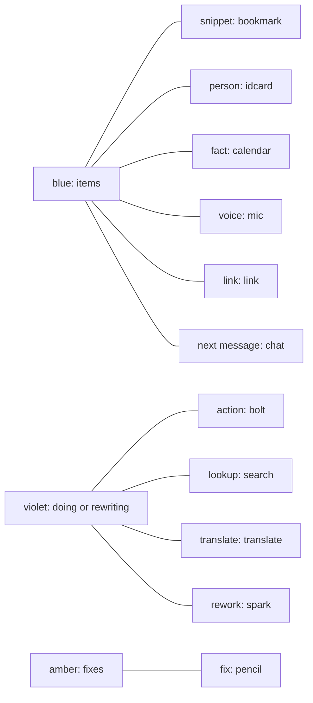

# Look

Drafter uses PixelKit, a small design system with pixel marks, two themes and three typefaces. The app adapts it to
native macOS. Everything is bundled. Nothing is loaded from the network.

Colours, faces and corners come from a theme: PixelKit's own look by default, three built-in skins, or your own JSON
file in `data/themes/`. Pick one in Settings > Look > Theme. [Themes](themes.md) describes the file.

## The PixelKit parts

| Part | File | What it holds |
|---|---|---|
| Colours | `app/PixelTokens.swift` | Paper (light) and Charcoal (dark) colours, generated from PixelKit tokens |
| Marks and glyphs | `app/PixelArt.swift` | 20 marks on a 16-cell grid and 16 line glyphs, as data |
| Theme | `app/Theme.swift` | `PK` drawing helpers, `Kind` (one mark and one colour per kind), `PKFont` |
| Fonts | `app/art/fonts/` | Fixel Text, Fixel Display and JetBrains Mono, with their licences |

`app/sync-pixelkit.py` copies all of these from a PixelKit checkout. Do not edit the generated files by hand. Change
the source and run the script again. `app/art/README.md` says the same for anyone who opens the folder. The fonts
are under the SIL Open Font License 1.1, which allows bundling them with software. `app/build.sh` copies
`app/art/` into the app's resources.

## The rules

- **Grey text stays plain.** It uses the field's own font at a lighter shade, with no fade. Only chips and marks
  carry style.
- **One mark and one colour per kind,** the same at the caret, in the strip and in the window.
- **Type.** Words are in Fixel Text. Titles and the strip's state word are in Fixel Display. Numbers, times and
  keys are in JetBrains Mono. Nothing is in all caps.
- **Corners.** 4 pt on chips and keycaps, 8 pt on controls and cards, 12 pt on the command panel.
- **The strip stays pure black** in both themes, so it merges with the notch. It has no border or glow.
- **Live is coral, done is mint.** A recording is coral. A take that landed shows the mint `verified` mark.
- **Native controls stay native.** Window chrome, switches, buttons and list selection follow macOS.

## Marks per kind of chip

`Kind` in `app/Theme.swift` maps each kind of offer to its mark and colour.



Blue kinds give you something. Violet kinds do or rewrite something. Amber marks a fix to your text. A quick-start
link (a preset) uses the link kind. A proofread chip uses the fix kind.

## Motion

- A chip fades in over 90 ms. Grey text has no fade.
- When a take lands, the `verified` mark draws in from left to right in three steps.
- During a long note or a call, four pixel bars per side show the level.
- Reduce Motion turns off the draw-in and the chip fade. The level bars still update, because they carry
  information.

## Preview renders

The app can draw its own screens with made-up data, without a microphone, an engine or any of your files. Use this
to check a visual change in both themes.

`app/Preview.swift` holds the render code (`UIShots.run`). It draws:

- the strip in each state: idle, listening, inserted, reading, an offer, a recording;
- the command panel, and grey text and chips at a caret;
- each window page: Voice, Calls & notes with a sample call and a long note, Typed, Clipboard, Shortcuts,
  Settings and Help;
- the window at its minimum size.

Every record in these pictures is invented. Settings numbers are made up too.

### Make them

```sh
zsh scripts/look-preview.sh /tmp/drafter-look
```

The script:

1. Builds a scratch copy of the app in a temporary folder.
2. Points its home at an empty temporary folder, so it never reads your `data/`.
3. Renders both themes into `<out>/light` and `<out>/dark` with `--ui-preview <dir>` (and `--dark`).
4. Deletes the scratch copy.

It never installs the app and never starts or stops a running copy. You can also call a built binary yourself:
`Drafter --ui-preview <dir>` for light, with `--dark` for dark.

## Known gaps

- PixelKit has no clipboard mark (`layers` stands in) and no stop glyph (the stop button keeps a system symbol).
- List selection uses the system highlight. A PixelKit tint would need a custom list with its own keyboard rules.
